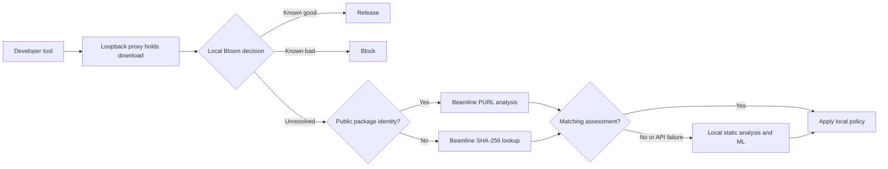

# hood

[](#what) [](https://github.com/atomdrift-project/hood/actions/workflows/ci.yml) [](https://scorecard.dev/viewer/?uri=github.com/atomdrift-project/hood) [](LICENSE)

> [!WARNING] This is experimental. It may eat your cat.
> 
<p align="center"></p>

## What

`hood` is a local enforcement layer for software fetched by developers and AI agents. It inspects unfamiliar public and private artifacts before release to package managers, installers, or `curl`, adding zero-day detection without changing workflows or sending proprietary packages to a third party.

## How it works



Hood creates a fresh CA for each intercepted command and trusts it only in that
child process; it never changes the host trust store. It buffers downloads in
memory or spills them to disk, holding their contents until assessment completes.
Local operations such as `go test`, `cargo build`, and `npm test` bypass the proxy.

Assessment uses three layers:

1. **Local Bloom filters from Atomdrift Scan.** Hood uses Scan's combined decision:
   every supplied identity must be blessed to skip inspection. A good package name
   alone cannot bless unknown bytes. Known-bad decisions block; conflicts and outside
   sightings continue to assessment. Bloom membership is probabilistic.
2. **Beamline.** Recognizable public packages use blocking `POST /v1/analyze?purl=…`.
   Other artifacts use `GET /v1/lookup?sha256=…`. Only an `analyzed` assessment with
   a matching SHA-256 and recognized severity is applied. If PURL analysis describes
   different bytes, Hood asks about the downloaded hash. Requests use
   `follow=references` and `false_positive_budget=25`.
3. **Local analysis.** Unknown artifacts, API outages, quota/rate limits, malformed
   answers, and interrupted streams fall back to Atomdrift Scan without retries.
   The analyzer loads only when needed. Suspicious and hostile assessments block by
   default; if local scanning also fails, Hood applies its existing `HOOD_BYPASS`
   policy. Downloads exceeding `HOOD_MAX_SCAN_MB` also follow that failure policy.

Beamline calls send only a public PURL or a SHA-256, plus assessment policy parameters.
They never upload artifact contents or forward download URLs, cookies, or registry
credentials. Authenticated requests, URLs with query parameters, scoped npm packages,
GitHub archives, and unrecognized origins use hashes. This minimizes disclosure;
PURLs still reveal dependencies and hashes can identify known artifacts. Source IPs
and an optional Beamline token can link requests.

Verified Beamline assessments are cached locally for **30 days** by default, across
Hood invocations. Reads do not extend the lifetime. Entries are keyed by the exact
artifact SHA-256 and isolated by API endpoint, credentials, and analysis policy;
PURL and hash requests for the same bytes can reuse the same assessment. Cached
assessments still pass through Hood's current enforcement policy and local Bloom
checks: a known-bad Bloom verdict blocks by default even when the cache says benign.
Unknown answers and API failures are not cached. Assessments without an
engine version expire after at most 60 seconds, matching Beamline's treatment of
unmeasured evidence.

The cache lives under the platform cache directory at `atomdrift/hood/beamline/v1`.
It stores assessments and timestamps, without request PURLs or credentials. Expired
entries are ignored and old files are pruned on the first cache miss in each invocation.
Unreadable, malformed, or unwritable caches do not prevent normal assessment.
`HOOD_LOCAL=1` also skips this cache, using only local Bloom checks and local scanning.

Beamline connections bypass proxy environment variables and reject redirects.
At most four requests run concurrently; excess work goes directly to local analysis.
Connection establishment has a five-second timeout, headers and stream inactivity
have a 30-second timeout, and a progressing analysis may run for up to 30 minutes.

| Setting | Purpose |
| --- | --- |
| `HOOD_BEAMLINE_URL` | API origin; defaults to `https://api.isotope13.ai`. HTTPS required except on loopback. |
| `HOOD_BEAMLINE_TOKEN` | Optional Beamline bearer token, separate from package-manager credentials. |
| `HOOD_BEAMLINE_CACHE_TTL_SECS` | Local assessment lifetime in seconds; defaults to `2592000` (30 days). Set `0` to disable caching. |
| `HOOD_LOCAL=1` | Use local Bloom filters and local analysis only. |
| `HOOD_NO_BLOOM=1` | Disable the Bloom gate and its automatic refresh. |
| `SCAN_BLOOM_DIR` | Use an explicitly managed Scan Bloom bundle; Hood does not update it. |
| `SCAN_NO_UPDATE=1` | Disable automatic Bloom refresh. |

Hood shares Scan's installed Bloom bundle and verified, atomic updater. It checks for
updates at most once per day, including failed attempts. Missing or unusable bundles
grant no skips; assessment continues through the other layers.

## Tool coverage

✅ = automatic coverage; ◐ = experimental or explicit coverage; — = unsupported. Matrix verified against each project's source (August 2026). Hood also supports arbitrary commands through `hood exec -- <command>`; only Hood locally classifies private artifact contents. Competitors may route private packages but decide from feeds or metadata.

| Tool | hood | [PMG](https://github.com/safedep/pmg) | [SCFW](https://github.com/DataDog/supply-chain-firewall) | [Safe Chain](https://github.com/AikidoSec/safe-chain) |
| --- | :---: | :---: | :---: | :---: |
| `curl` | ✅ | — | — | — |
| `wget` | ✅ | — | — | — |
| `npm` | ✅ | ✅ | ✅ | ✅ |
| `npx` | ✅ | ✅ | — | ✅ |
| `pnpm` | ✅ | ✅ | — | ✅ |
| `pnpx` | ✅ | ✅ | — | ✅ |
| `yarn` | ✅ | ✅ | — | ✅ |
| `rush` | ✅ | — | — | ✅ |
| `rushx` | ✅ | — | — | ✅ |
| `bun` | ✅ | ✅ | — | ✅ |
| `bunx` | ✅ | — | — | ✅ |
| `pip` | ✅ | ✅ | ✅ | ✅ |
| `pip3` | ✅ | ✅ | — | ✅ |
| `pipx` | ✅ | ✅ | — | ✅ |
| `uv` | ✅ | ✅ | — | ✅ |
| `uvx` | ✅ | ✅ | — | ✅ |
| `poetry` | ✅ | ✅ | ✅ | ✅ |
| `pdm` | ✅ | — | — | ✅ |
| `go` | ✅ | ◐ | — | — |
| `cargo` | ✅ | — | — | — |
| `zig` | ✅ | — | — | — |
| `brew` | ✅ | — | — | — |
| `pacman` | ✅ | — | — | — |
| `yay` | ✅ | — | — | — |
| `paru` | ✅ | — | — | — |
| `makepkg` | ✅ | — | — | — |
| `dnf` | ✅ | — | — | — |
| `yum` | ✅ | — | — | — |
| `zypper` | ✅ | — | — | — |
| `rpm` | ✅ | — | — | — |
| `apk` | ✅ | — | — | — |
| `pkg` | ✅ | — | — | — |

## Deploy — Rust 1.96+

```sh
git clone https://github.com/atomdrift-project/hood.git
cd hood
make install
hood install
```

`hood install` adds user-level shims for supported tools already on `PATH`; it requires no system proxy, root CA, or package-manager reconfiguration. Restart the shell and use those tools normally. On macOS, Go needs no manual `SSL_CERT_FILE` setup: Hood preserves `GOPROXY` and `GOSUMDB` verification through a loopback bridge. Zig trusts only fixed system certificate stores, so during `zig build` and `zig fetch` Hood refuses tunnels from Zig's own HTTP client; Zig then sends each dependency request over loopback HTTP and Hood fetches it over verified TLS. Tools run by build steps, such as `curl` or `git`, keep the normal intercepted path and trust Hood's per-run CA.

Set `HOOD_VERBOSE=1` (or use `-v`) for per-artifact results and a run summary:

```text
✅ Atomdrift Hood scan passed — 3.2% risk score — package.tgz
⚠️ Atomdrift Hood flagged this download as suspicious — 31.0% risk score — BLOCKED
🛑 Atomdrift Hood blocked a high-risk download — 87.0% risk score
🛑 Atomdrift Hood scanned 11 downloads — 8 passed, 2 suspicious, 1 high risk — 2 blocked
```

## GitHub Actions

Pin Hood to a reviewed commit, install its shims, and run existing build commands unchanged:

```yaml
steps:
  - uses: actions/checkout@3d3c42e5aac5ba805825da76410c181273ba90b1 # v7.0.1
    with:
      persist-credentials: false
  - uses: actions/checkout@3d3c42e5aac5ba805825da76410c181273ba90b1 # v7.0.1
    with:
      repository: atomdrift-project/hood
      ref: <reviewed-hood-commit-sha>
      path: .hood-source
      persist-credentials: false
  - name: Install Hood
    env:
      RUSTUP_TOOLCHAIN: 1.96.0
    run: |
      rustup toolchain install 1.96.0 --profile minimal
      make -C .hood-source install
      hood install
      echo "$HOME/.hood/bin" >> "$GITHUB_PATH"
  - name: Install dependencies through Hood
    run: npm ci # or: go mod download, pip3 install -r requirements.txt
```

Uninstall with `hood uninstall`; it removes Hood's shims and shell configuration.
